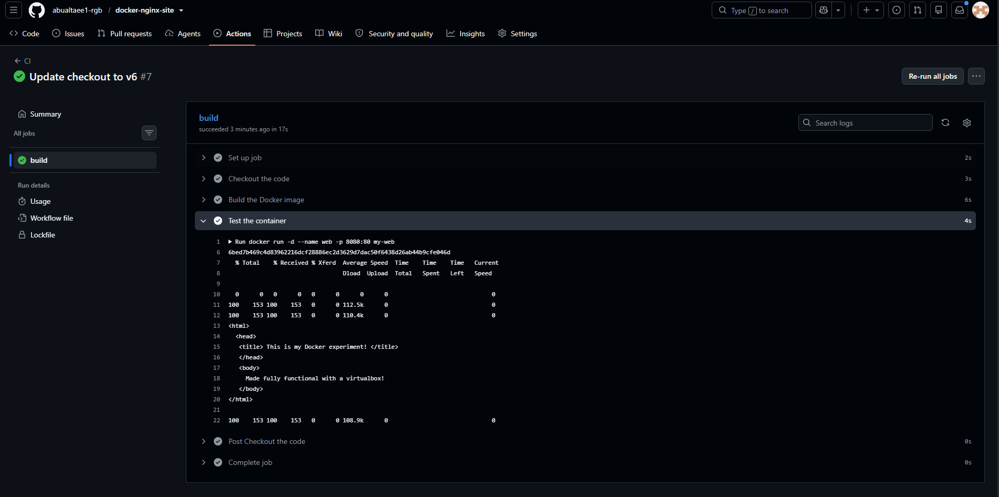

# Docker nginx Site

A small static web page served by nginx in a Docker container, built from my own Dockerfile. It runs on my hardened Ubuntu Server VM from [linux-homelab](https://github.com/abualtaee1-rgb/linux-homelab). This is the third project in my DevOps portfolio.

Tested on Ubuntu Server 26.04 LTS (VirtualBox VM) with Docker 29.1.3 (Ubuntu's `docker.io` package).

## What it does

- The `Dockerfile` starts from the official `nginx` image and copies `index.html` into the folder nginx serves pages from.
- The container publishes its port only on the VM's own loopback address (`127.0.0.1`), so nothing else on the network can reach it.
- A restart policy (`unless-stopped`) starts the container again automatically after a reboot.
- A GitHub Actions workflow builds the image, tests the container and publishes it to GitHub Container Registry on every push to `main`.

## Dockerfile

```
FROM nginx
COPY index.html /usr/share/nginx/html/
```

## How to run it

```bash
sudo docker build -t my-web .
sudo docker run -d -p 127.0.0.1:8080:80 --name web my-web
curl http://127.0.0.1:8080
sudo docker update --restart unless-stopped web
```

## Decisions

- **`sudo docker`, not the `docker` group.** Membership in that group is effectively root access on the host, which doesn't fit a server I'm trying to harden.
- **Port bound to `127.0.0.1`.** Docker publishes ports on all interfaces by default, and I only wanted local access.
- **`unless-stopped`, not `always`.** If I stop the container on purpose, it stays stopped after a reboot.

## Evidence

Files in [`docker-evidence`](docker-evidence):

- `docker-ps-evidence.txt`: the running container and its port mapping
- `docker-webpage-evidence.txt`: the page returned by `curl`
- `docker-uptime-evidence.txt`: VM uptime after the reboot test
- `docker-boot-evidence.txt`: Docker starting about 6.5 seconds after boot, and the container starting right after it
- `actions-test-step.png`: GitHub Actions log showing the container started in CI and `curl` returning the page

## What broke and how I fixed it

**1. The Dockerfile mixed up two sets of paths.** `COPY` takes a path on my machine (relative to the build folder) and a path *inside the image*. I wrote laptop-style paths for both. The fix was `index.html` as the source and `/usr/share/nginx/html/` as the destination.

**2. `docker build` needs a build context.** I left off the final `.`, and Docker answered "requires 1 argument". The dot tells Docker which folder to send to the daemon.

**3. Changing the file didn't change the page.** `COPY` runs once, at build time, so the container served the old snapshot. I had to rebuild the image and start a new container.

**4. Two timestamps didn't match.** After the reboot test, the VM's boot time came out *later* than the container's start time, which can't be right. Docker's boot log counts seconds since power-on instead of using the clock, and it showed Docker starting 6.5 seconds after boot. I believe the VM's clock was adjusted after startup, but I didn't confirm that, so I used the boot log as my evidence.

## CI/CD with GitHub Actions

Every push to `main` triggers a GitHub Actions workflow (`.github/workflows/ci.yml`) that runs on an `ubuntu-latest` runner:

1. **Checkout the code** with `actions/checkout@v6`.
2. **Build the Docker image** with `docker build -t my-web .`.
3. **Test the container.** The workflow starts it with `docker run -d --name web -p 8080:80 my-web`, waits a few seconds for nginx to start, and requests the page with `curl --fail`. If the server does not answer, the step fails and the run turns red.
4. **Publish the image to GitHub Container Registry.** The workflow logs in to `ghcr.io` with the automatic `GITHUB_TOKEN` and pushes the image as `ghcr.io/abualtaee1-rgb/docker-nginx-site:latest`. The job only has `contents: read` and `packages: write` permissions (least privilege).



The log shows the page content returned by the container, which confirms that the image builds and serves the site on every push.

### What broke in CI

- **Account locked due to a billing issue.** The first run failed with *"The job was not started because your account is locked due to a billing issue"*. I had removed my billing information after an earlier paid subscription. I added my card details back to my GitHub account, re-ran the workflow and it passed.
- **Invalid workflow file (run #2).** GitHub reported a YAML syntax error on line 10. I rewrote the file with consistent two-space indentation and the next run passed.
- **Exit code 127 in the test step.** I had misspelled `docker` in the workflow. Exit code 127 means "command not found", and the log line before the error showed which command failed.
- **Node.js 20 deprecation warning.** The workflow warned that `actions/checkout@v4` runs on Node 20. I updated to `@v6`, which runs on Node 24, and the warning disappeared.
- **`denied` when pushing to GHCR.** The first push uploaded the image layers but ended with `error from registry: denied`. After the package had been created and linked to the repository, I re-ran the workflow and it succeeded. I did not change the workflow file, so I can't say for certain what caused it.

## Limitations and next steps

- I haven't tested how Docker's published ports interact with UFW. Docker writes its own firewall rules, which can bypass UFW, so I kept the port on the loopback address.
- One container only. Next: Docker Compose.
